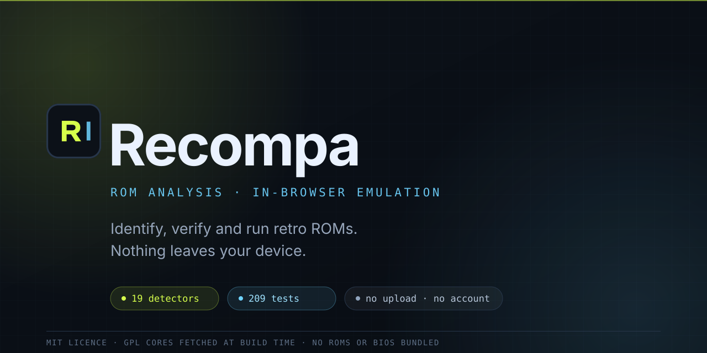

<p align="center">
  
</p>

<p align="center">
  <a href="https://recompa.vercel.app"><strong>Open the app →</strong></a>
</p>

<h1 align="center">Recompa</h1>

<p align="center">
  Drop a retro ROM in. Recompa tells you what it actually is, whether it can run,
  and runs it — without uploading anything.
</p>

---

## What it does

Recompa reads the **bytes** of a file rather than trusting its name. It identifies
the platform from signatures, headers, footers and chequer patterns, verifies
integrity with checksums, resolves multi-file disc sets, and then either runs the
game in the browser or tells you precisely why it cannot.

There is no account, no server-side processing and no telemetry. ROMs stay in
your browser's IndexedDB and are never transmitted anywhere.

### Three things it refuses to do

1. **Guess a platform.** If no signature matches, it says *format unknown* and
   shows you the first bytes rather than producing a plausible-looking answer.
2. **Claim compatibility it has not tested.** Every row in the
   [compatibility matrix](docs/COMPATIBILITY-MATRIX.md) records what is
   implemented versus what someone has watched running.
3. **Ship ROMs or BIOS files.** Neither is present in this repository, and
   neither is downloaded at build or run time.

## Features

| | |
| --- | --- |
| **Detection** | 19 platforms with byte-level detectors, at signature, footer or structural strength — see [detection coverage](docs/DETECTION-COVERAGE.md) |
| **Disc sets** | `.cue`/`.m3u`/`.ccd` companion resolution, multi-track handling, one logical entry per disc, honest errors for incomplete rips |
| **Folder scanning** | Point at a folder once; recursive intake, per-folder grouping, and **rescan** via a retained `FileSystemDirectoryHandle` — see [folder scanning](docs/FOLDER-SCANNING.md) |
| **Emulation** | NES (jsnes), Game Boy / Color / Advance (mGBA), PlayStation (EmulatorJS + pcsx_rearmed) |
| **Firmware** | PlayStation BIOS supplied by you, validated for size, stored locally, never bundled — see [PlayStation notes](docs/PLAYSTATION.md) |
| **Analysis** | SHA-1/SHA-256/MD5, header parsing, entropy, region and serial extraction, per-file technical reports |
| **Saves** | SRAM and save states in IndexedDB, with export/import |

## Supported platforms

**Playable** — NES, Game Boy, Game Boy Color, Game Boy Advance, PlayStation
(requires your own BIOS dump).

**Identified, engine not installed** — SNES, Mega Drive / Genesis, Master
System, Game Gear, PC Engine, Nintendo 64, Nintendo DS, PlayStation Portable,
Atari 2600, Atari 7800, Atari Lynx, WonderSwan / Color, Virtual Boy, Neo Geo
Pocket / Color.

That second list is deliberately called *identified*, not *supported*. Detection
is implemented and tested; playback is not, and the app says so in the engine
plan instead of failing silently at launch.

**Not supported** — PlayStation 2, Dreamcast, GameCube, Saturn, Xbox. No
detector, no adapter, no claim.

## Quick start

```bash
git clone https://github.com/LIN4CRE/Recompa.git
cd Recompa
npm ci
npm run dev
```

The dev server starts on <http://localhost:5173>.

EmulatorJS and the PlayStation core are **GPL** and are therefore not committed.
`npm run build` fetches them into `public/cores/` at build time (you become a
distributor when you serve them — see
[`docs/PLAYSTATION.md`](docs/PLAYSTATION.md)).

```bash
npm test           # unit tests (framework-free fixtures, real byte layouts)
npm run typecheck  # tsc -b, no emit
npm run build      # production build, self-fetches cores
```

## Architecture

```
src/
  core/      detection, disc sets, planner, hashing, folder scanning, BIOS
  engines/   jsnes / mGBA / EmulatorJS adapters behind one interface
  db/        IndexedDB schema and accessors (games, payloads, sram, bios, folders)
  ui/        React pages and components
  state/     zustand stores
tests/unit/  fixtures are real byte layouts, not mocks
```

The engine adapters share a single `EngineAdapter` contract, so adding a console
means writing a detector, an adapter and a descriptor — not touching the UI.
See [`docs/ARCHITECTURE.md`](docs/ARCHITECTURE.md) and, for contributing a
platform, [`docs/ADDING-ENGINES.md`](docs/ADDING-ENGINES.md).

## Testing philosophy

Fixtures are built to the real byte layout of each format, and every detector
has a **negative** test that feeds it noise and asserts it declines. A detector
that guesses is treated as a bug, not a feature.

```bash
npm test                      # unit + processing-service integration tests
npm run test:e2e:install      # then:
npm run test:e2e              # Playwright, if you have browsers available
# Restricted environment? Supply any Chromium binary instead:
#   PLAYWRIGHT_CHROMIUM_EXECUTABLE_PATH=/path/to/chromium npm run test:e2e
# See docs/DEPLOYMENT.md §1.
```

## Licence and legal

Recompa's own source is **MIT**. It links against GPL-licensed emulator cores
which are fetched at build time and are not part of this repository. See
[`THIRD-PARTY-NOTICES.md`](THIRD-PARTY-NOTICES.md) and `assets/licenses/`.

You must supply your own ROMs and BIOS dumps. Dumping media you own is legal in
many jurisdictions; downloading commercial ROMs generally is not. Nothing here
is a way to avoid owning the game.

## Support

Recompa is independent, ad-free and has no paid tier. If it is useful to you and
you feel like it, you can
**[buy the developer a smoke](https://paypal.me/dlinacre16)** 🚬. Entirely
optional — the app is fully functional either way, and no payment detail ever
touches Recompa.
